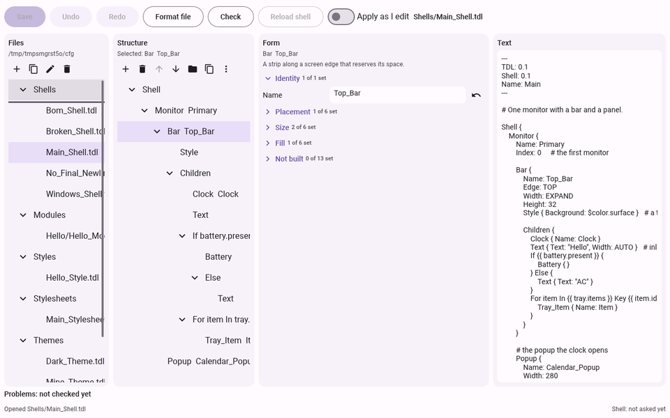
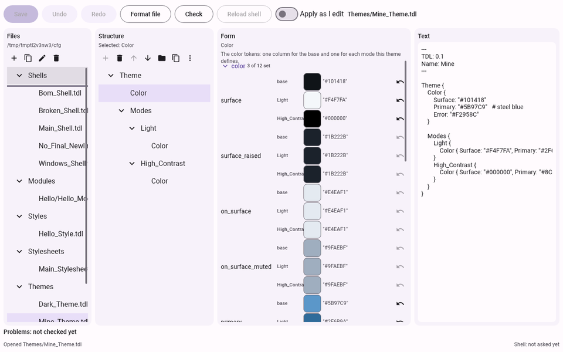
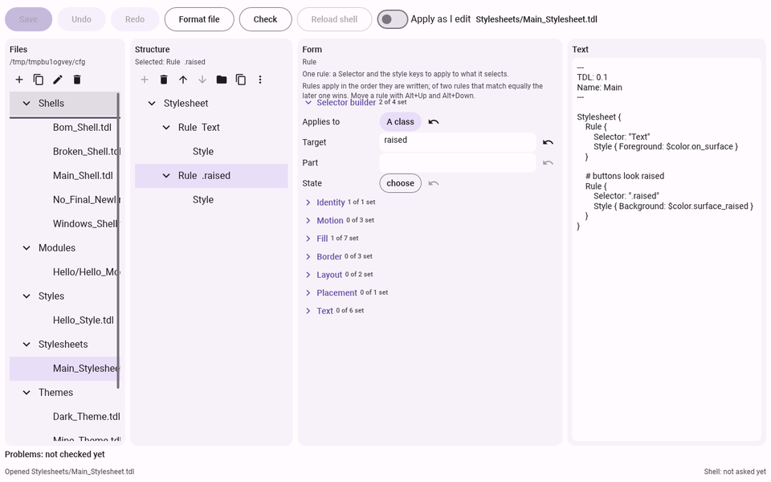

# The Shell Configuration App

`apps/shell_config/` in the Tesserae UI repository is a complete application built with Tesserae UI: the graphical editor for the files of Tesserae Shell. It is a good example of a
real app: a ViewModel over a plain-Python model, one view file, a stylesheet, the toolkit's `Tree` and `TextInput`, keyboard shortcuts and a headless test that drives the window with key events only.

It is its own package (`tesserae-shell-config`, import `tess_shell_config`, command `tesserae-shell-config`) with its own `pyproject.toml`. The first half of this page is for the person who configures a shell with it;
the second half is for the person who reads it as an example of a Tesserae UI application.

## Using it

The application edits the `.tdl` files of your shell's configuration folder in place. It changes only the lines you change: comments, blank lines and the order of everything else stay as you wrote them. It needs
the `tesserae-shell` command on the `PATH` (it asks it for the schema, so a form never offers a key the shell does not know) and Python 3.14.

```bash
tesserae-shell-config                        # the folder the shell names, else ~/.config/tesserae-shell
tesserae-shell-config --config-dir ~/shell   # a folder of your own
```



The window has four areas side by side: **Files** (the folder by type: shells, modules, styles, stylesheets, themes, settings), **Structure** (the open file's blocks as a tree), **Form** (the keys of the selected
block, in groups, each with its doc line as a tooltip) and **Text** (the same file as TDL). Below them are the **Problems** list and the status line. Choosing a block selects it in the Form; editing in the Text area
updates the others as soon as the text parses.

### Open a folder and a file

Start the command with `--config-dir`, or without it for the folder the shell names. In the Files area press Enter on a file. A file with a syntax error opens in the Text area only, with its errors listed (line, column, what is
wrong); the Structure and Form come back when it parses.

### Edit a bar

1. Open your shell file (`Main_Shell.tdl`), choose the **Bar** in the Structure tree.
2. In the Form, open a group (Enter on its header) and change a value: type in the field and press Enter (or leave it); a switch toggles with Space; a choice (`Edge`, `Layer`) opens a list; a colour opens the colour picker.
   A number outside the key's range is refused and the message says the range. The reset button next to a key removes it from the file, which gives its default.
3. Add something to the bar with **Add child** (Ctrl+Shift+N): a list of what a bar may hold. It is written with its required keys only. **Move up** and **Move down** (Alt+Up, Alt+Down) reorder; **Move to** (Ctrl+Shift+M) moves a block into another block; **Duplicate** (Ctrl+Shift+D) copies it with a new `Name`.

Nothing reaches the disk until you **Save** (Ctrl+S), unless you turn on **Apply as I edit**.

### Add a module

Select the `Children` block of a bar, a panel or a layout and choose **Add child**. The list has the blocks the schema allows there and then **every module the shell ships** and **every module of your own** found
in the folder's `Modules/` folder: the application reads each module file's `Params` block, so your module shows its params (with their names and types, and no doc line, because the file has none) as the form of a call.
The form of any module call lists the module's params first, with their type, default and doc, then the keys every module takes.

### Change a theme colour

Open a theme file (`Themes/…_Theme.tdl`) and choose a token group in the Structure tree (`Color`, `Type`, `Shape`, `Space`, `Elevation`, `Motion`). The Form lists the tokens of the group with one column for the base and one for
each mode the file defines (Light, Dark, High_Contrast, Reduced_Motion); a colour token has a swatch in every column. Choosing a colour for a mode writes it under that mode, and nothing else.



To add a mode, choose `Modes` and **Add child**; the new mode is a new column. To remove one, remove its block from the Structure. A theme file's `Add child` also offers the token groups the file does not have yet.
A key that takes a colour (a bar's `Background`, a rule's `Foreground`) has a token button next to it: it lists the theme's tokens of the groups the key accepts, the preferred ones first, each with its value; choosing one writes `$color.surface`.

### Write a stylesheet rule

Open a stylesheet file and choose **Add child** on `Stylesheet`: a `Rule`. Rules are applied in the order they are written, and of two rules that match equally the later one wins, so the Structure lists them in order with their selector
(`Rule  Text:hovered`) and **Move up** and **Move down** change the order.



The Form of a rule starts with the **selector builder**: what the rule applies to (a block or module name, a class, a name), its target, a part of a module (`Slider::track`) and a state (`hovered`, `pressed`, `disabled`, `selected`,
`checked`, `focused`). Each change writes the whole `Selector:` line. Below it are the style keys: those the selector's block type takes when it names one, every style key for a class or a name. A selector the builder cannot read
(`Button .child`, an unknown state) is shown as written, with the style keys of every block type, and you edit it in the `Selector` key or the Text area.

### Settings and other files

`settings.tdl` shows its sections as pages: choose `Logging`, `Appearance`, `Directories`, … in the Structure. A section the file does not have yet is in the **Add child** list of the root block. A `Popup` with the name of a popup
a module opens by default (the Tray menu, say) shows that popup's values as its placeholders and says that it replaces the default whole.

The Files area makes a **new file** from a type (Ctrl+N: the type, then a name; the file has its metadata block and an empty root block), **duplicates** (Ctrl+Alt+D) and **renames** (F2) a file (its metadata `Name` follows), and
**deletes** (Delete): the file moves to the `trash` folder of the application's own state folder and is never removed.

### Undo, save and check

**Undo** (Ctrl+Z) and **Redo** (Ctrl+Y) step through the open file's edits, each form, structure or text edit being one step, and bring back the same bytes. **Save** writes the file through a temporary file and a rename, and the first save
of a file keeps the old content in the state folder's `backups`. After a save the application runs the shell's `check` on a worker thread and lists the findings under the areas: an icon, a word (Error, Warning, Note), `file:line:column` and
the message. Click a finding, or Tab to it and press Enter: its file opens, its block is selected and the key's widget has the focus. A file that another program changed while it is open is never overwritten without your answer:
a banner asks Reload or Keep mine.

### The keyboard map

Every action works from the keyboard alone; the buttons, the Structure menu and these keys do the same things. F6 is the way out of the text editor, which takes Tab for itself.

| Keys | Does |
|---|---|
| Tab, Shift+Tab | Move through the toolbar, the Files tree, the Structure tree, the form and the text |
| Arrow keys, Enter | Move in a tree, open or select the row |
| Space, Enter | Toggle a switch, press a button, open or close a group of keys |
| Enter, or Tab out of a field | Write the field's value (nothing is written while you type) |
| Up, Down (in a number field) | One step of the key's `step`, inside its range |
| Escape | Close a list, a menu or a dialog |
| Ctrl+S | Save the open file |
| Ctrl+Z | Undo |
| Ctrl+Y, Ctrl+Shift+Z | Redo |
| F6, Shift+F6 | Move the focus to the next, or the previous, of the areas: Files, Structure, Form, Text, and Problems when it lists something |
| F5 | Run `check` on the folder (the Check button) |
| Ctrl+Shift+R | Ask the running shell to reload (Reload shell) |
| Ctrl+Shift+A | Switch "Apply as I edit" on or off |
| Ctrl+Shift+L, Ctrl+Shift+U | The file changed on disk: reload it from disk (L), or use your version, Keep mine (U; Ctrl+K and Ctrl+J are the text editor's own) |
| Ctrl+N | A new file from a type (a list of the types, then a name) |
| F2 | Rename the file chosen in the Files area |
| Ctrl+Alt+D | Duplicate the file chosen in the Files area |
| Delete (in the Files area) | Delete the file: it moves to the trash folder of the state folder |
| Ctrl+Shift+N | Add a child to the selected block (a list of the blocks the schema lets it hold) |
| Delete (in the Structure tree), Ctrl+Shift+Delete | Remove the selected block |
| Alt+Up, Alt+Down | Move the selected block up or down among its siblings |
| Ctrl+Shift+M | Move the selected block into another block, chosen from a list |
| Ctrl+Shift+D | Duplicate the selected block (a `Name:` becomes a name no other block has) |
| Menu key, Shift+F10 | The Structure menu, with every action and its shortcut |

Every area, button, form row and menu entry has an accessible name, and a description (the key's doc line for a form row), for a screen reader.

## How it is put together

| Part | Does |
|---|---|
| `schema.py` | Reads the schema the `tesserae-shell` command exports into typed classes; refuses a major version it does not know. No key name is written in the code |
| `shell.py` | Runs `tesserae-shell schema`, `check` and `status` as short-lived subprocesses with a timeout, off the UI thread (`Offload` posts the answer to the loop with `app.thread_handle().call_soon`) |
| `files.py`, `folder.py` | Lossless reading and an atomic write of the `.tdl` files, a backup of the first save, the folder's files by type |
| `model.py` | One open file: its text, its lossless tree, a history of snapshots for undo and redo, and a selection kept by index path |
| `viewmodel.py`, `Views/` | The window: `Signal`s for the areas and a handler for each action |
| `usermodules.py`, `selector.py` | The user's own modules (the `Params` of the files in `Modules/`, read with `tess_dl` and added to the schema as modules) and the stylesheet selector (parsed into a block or module name, a class, a name, a part and a state, and written back as one `Selector:` edit) |
| `fileops.py`, `fileactions.py` | The Files area's new file from a type, duplicate, rename and delete (a move to the trash folder of the state folder: nothing is removed), and the name prompt they share |
| `services.py`, `problems.py`, `watcher.py`, `settings.py` | `check` and the problems list, status, reload, "Apply as I edit", saving, the file watch (see below) |

## Driving a window from a test

The app's tests build the window with `App(...)` over a copy of a configuration folder in `tmp_path`, advance frames, and press keys with `window.simulate("key_down", key=...)`. A key goes to the
focused node and bubbles to the view's root, where `handlers: {on_key: ...}` hears it; that is how the window's shortcuts work wherever the focus is. A multi-line `TextInput` takes Tab itself, so
the window gives the keyboard a way out (F6 moves between the three areas).

## The form generator (a generated form from data)

The Form area shows the keys of the selected block, one row each, **generated entirely from the schema**: no key name, enum value or default is in the code. It is a good example of data-driven views.

| Part | Does |
|---|---|
| `widgets.py` | A *registry* from a schema kind to a widget (switch, choice, number, length, sides, colour, text, path, icon, font, key chord, list, and the generic TDL field). A widget reads a value from the file, says what it shows, and turns an edit into TDL text or refuses it with a message. A new widget plugs in with one line: `registry.register("icon", IconWidget)` (and the cell shape it draws, in `Views/Main_View.yaml`) |
| `form.py` | `Form.build(model)` makes the rows by the schema's groups; `commit`, `reset`, `toggle_expression`, `use_token` are one `DocumentModel` edit each; `coverage(schema)` lists the keys that got the generic field, with the reason |
| `formcontrol.py` | Puts the form's `Signal`s and handlers on the window's ViewModel, keeps the focus on the row being edited while it is built again from the file, and drives the picker list and the file dialog |

Things the toolkit made us do, which any big generated view meets: the view language redraws the whole window after a change, so the form builds only the groups that are open (a closed group is one header), the window is updated inside one `batch(...)`, and a commit that arrives while the form is being rebuilt (the old field losing its focus) is ignored.

The icon, font, key-chord, list and token widgets are the toolkit's own: `IconPicker` (given the configuration folder's `Icons/` folder through the toolkit's file system), `FontList`, `KeyChordField`, `ListEditor` (given the schema's item kind, choices and range) and `TokenButton` (given the tokens of the groups a key accepts and its `preferred_tokens`). Each is a `widget:` call inside the cell of `Views/Main_View.yaml` and a handler that passes what it holds to `form_commit`.

## Editing the structure (add, remove, move, duplicate, undo)

| Part | Does |
|---|---|
| `blocks.py` | What a block may hold (`children_of`: the schema's `allowed_children`, then the shipped modules for a block that takes module calls) and what a new block is written as (`new_block_text`: the required keys, a unique `Name`, laid out by `tess_dl.format_block`) |
| `model.py` | `add_block`, `remove_block`, `move_block`, `duplicate_block`: each is one `tess_dl` edit and one history state. The selection is followed across the edit as a place counted in blocks only (`tdl.ordinals`), because an edit can take a comment away with a block and shift every entry number after it |
| `actions.py` | `StructureActions`: which actions the selection allows (the buttons and the menu are dimmed from it), the choice lists for Add and Move to, and the messages. A refused edit (`EditError`) is shown in the status line and changes nothing |
| `shortcuts.py` | Ctrl+Shift+N, Delete, Alt+Up and Down, Ctrl+Shift+M, Ctrl+Shift+D, the Menu key and Shift+F10; a right click in the Structure area is wired in `app.py` |

Two things any editor over a lossless tree meets. A selection kept as an index path is wrong after an edit that removes a block together with the comment on its line (every later entry number is one or two lower), so the model keeps it as a count of blocks, `If`s and `For`s only and converts it back with `Document.at`'s paths. And a block moved or copied as text carries its original indentation on every line after the first, while `Block.with_child` adds the new place's indentation to every line, so the text is dedented first.

## Check, saving and the file watch (what the shell command and the disk do to a window)

A window that talks to a command and to the disk has three jobs that must never run inside a frame, and one that must never run behind the person's back.

| Job | How |
|---|---|
| `check`, `status`, `reload` | `Services` hands each call to an `Offload`: a worker thread runs the subprocess (10 s timeout) and posts its answer with `app.thread_handle().call_soon`, so the callback runs on the loop thread and may touch Signals. One `check` runs at a time; one asked for meanwhile runs when the first ends. A run that fails or times out is one row in the Problems list and editing goes on. A test that has no loop gives `Services.offload` an `InlineOffload` (the same call, at once) or its own `post` queue (to prove the call returns before the answer) |
| The Problems list | `problems.rows_for` makes a row of each finding with an icon and a word (an icon alone is not a message). A click, or Enter on the row, calls `problems.locate`: the deepest block, `If` or `For` of the open document whose `node.origin` holds the finding's line and column, and the property inside it. The path comes from `node.index_path`; a key in a nested `Style { }` belongs to the block that holds the `Style` |
| Saving | An explicit save, and "Apply as I edit" (a switch kept in the app's own state folder): after each commit the file is written by the same atomic save, a text edit once it rests 200 ms and only when it parses. After a save the app runs `check`, asks `status`, and asks the shell to `reload` only when it is running and the setting is on (or on the Reload button) |
| The file watch | `watchfiles.watch` runs on a worker thread and posts the bytes of each changed `.tdl` file. The decision is made on the loop thread: a file whose bytes are what the model last read or wrote is the app's own save and is ignored (no timing guess), anything else asks Reload or Keep in a banner. A save is also refused (`ChangedOnDisk`) when the file on disk is not what the model expects, so nothing is ever overwritten silently even if the watch is late |

Two lessons. A multi-line `TextInput` takes some Ctrl+letter keys for its own (Ctrl+J and Ctrl+K), so a shortcut meant to work while the editor has the focus must use another letter. And a rebuild of a form row (a new `key` in a `for:`) takes the keyboard focus from every node, after which no key press reaches the view's root: a handler that rebuilds the window gives the focus back (`Shortcuts.keep_focus`).
